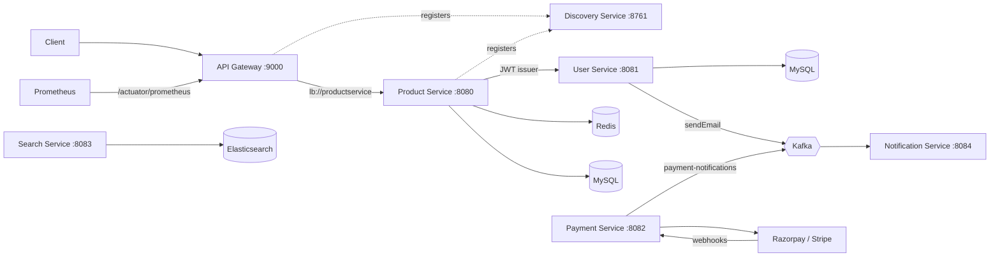

# Cartograph

[](https://github.com/ShazAhmed10/cartograph/actions/workflows/ci.yml)

An event-driven commerce backend, split into seven independently deployable Spring Boot services
behind an API gateway, with service discovery, OAuth 2.0 authentication, payment-provider webhooks,
Kafka messaging, Redis caching and Elasticsearch search.

## Architecture



## Services

| Service | Port | Responsibility | Key technology |
|---|---|---|---|
| [`api-gateway`](api-gateway) | 9000 | Single entry point, load-balanced routing, metrics | Spring Cloud Gateway, Micrometer |
| [`discovery-service`](discovery-service) | 8761 | Service registry | Netflix Eureka |
| [`user-service`](user-service) | 8081 | Signup, login, roles, token validation, OAuth 2.0 authorization server | Spring Security, JWT, Flyway |
| [`product-service`](product-service) | 8080 | Products and categories, read-through cache | Spring Data JPA, Redis, OAuth 2.0 resource server |
| [`payment-service`](payment-service) | 8082 | Payment links and provider webhooks | Razorpay, Stripe, Kafka |
| [`notification-service`](notification-service) | 8084 | Consumes events and sends email | Kafka, JavaMail |
| [`search-service`](search-service) | 8083 | Product indexing and search | Elasticsearch |

## How it fits together

- **Authentication:** `user-service` issues tokens and `product-service` validates them as an
  OAuth 2.0 resource server, so product requests need no call back to the auth service.
- **Asynchronous email:** signup publishes to the `sendEmail` Kafka topic and `notification-service`
  sends the email, so a slow mail server never holds up signup.
- **Caching:** `product-service` reads through Redis before going to MySQL.
- **Payment gateways:** Razorpay and Stripe sit behind a common client interface, and each reports
  back through its own webhook endpoint.
- **Discovery:** services register with Eureka, and the gateway resolves them by name rather than by
  host and port.

## Running locally

Requires Java 21, Maven and Docker.

```bash
cp .env.example .env        # then fill in your values
docker compose up -d        # MySQL, Redis, Kafka, Elasticsearch, Prometheus

set -a; source .env; set +a # export the settings to this shell
```

Start `discovery-service` first, then the others, each in its own terminal:

```bash
cd discovery-service && mvn spring-boot:run
```

The Eureka dashboard is at <http://localhost:8761>, and API traffic goes through
<http://localhost:9000>.

## What I'd improve next

- Add integration tests with Testcontainers, so CI can run real tests rather than only building.
- Replace the fire-and-forget Kafka publish with a transactional outbox and dead-letter handling.
- Route the remaining services through the gateway.
- Containerise the services so the whole platform starts with one command.
